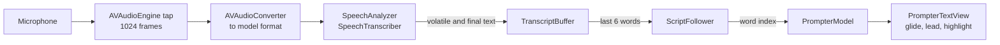

# Presenter

Presenter is a native macOS teleprompter that follows your voice. It listens to the microphone, finds your place in the script, and scrolls the text while you speak. Speech recognition runs on the Mac. No audio or text leaves the computer.

**Download:** [latest release](https://github.com/Marceswan/mac-presenter/releases/latest) (signed with Developer ID and notarized by Apple).

## Contents

- [Features](#features)
- [Requirements](#requirements)
- [Install](#install)
- [Quick start](#quick-start)
- [Write a script](#write-a-script)
- [Use the prompter](#use-the-prompter)
- [Keyboard shortcuts](#keyboard-shortcuts)
- [Settings](#settings)
- [How voice following works](#how-voice-following-works)
- [Architecture](#architecture)
- [Build from source](#build-from-source)
- [Tests](#tests)
- [Release](#release)
- [Troubleshooting](#troubleshooting)
- [Privacy](#privacy)
- [Known limitations](#known-limitations)

## Features

- **Local presentation library.** Save multiple named presentations, reopen them later, and restore the last open presentation when the app launches. Edits save automatically; Cmd+S saves immediately.
- **Document imports.** Import plain text, Markdown, RTF, and Word DOCX files as editable teleprompter text.
- **Voice following.** The prompter scrolls when you speak and stops when you stop. You do not set a speed.
- **On-device recognition.** Presenter uses Apple's SpeechAnalyzer framework. The audio stays on the Mac.
- **Tolerant matching.** Ad-libs, filler words ("um", "uh") and misheard words do not move the prompter. If you skip a sentence, the prompter finds you again after about 3 words. If you read a sentence again, it goes back.
- **Smooth motion.** The text glides up while you read across a line. A pace estimate keeps the scroll up to 2 words ahead, which hides the recognizer delay.
- **Spoken-word highlight.** Each word that the prompter tracks gets a blue-purple-orange gradient sweep, then fades to a dim color.
- **Cues.** Text in square brackets, such as `[PAUSE]`, stays on the screen. The prompter does not wait for you to say it.
- **Manual control.** Scroll with the trackpad or the arrow keys at any time. Voice following continues from the line at the reading markers.
- **Studio options.** Mirror mode for beam-splitter glass, keep on top, full screen, three color themes, adjustable reading line.

## Requirements

| To run the app | To build from source |
| --- | --- |
| macOS 26 or later | Xcode 27 or later |
| Apple Silicon recommended | [XcodeGen](https://github.com/yonaskolb/XcodeGen) (`brew install xcodegen`) |
| A microphone | An Apple Developer certificate (for a signed build) |

## Install

1. Download `Presenter-<version>.dmg` from the [releases page](https://github.com/Marceswan/mac-presenter/releases).
2. Open the DMG. Drag **Presenter** to **Applications**.
3. Open Presenter from Applications.
4. The first time you start listening, macOS asks for microphone access. Click **Allow**.
5. If the speech model for your language is not on the Mac yet, the status overlay shows "Downloading the speech model". macOS downloads it one time.

### Updates

Presenter 0.3.0 and later update automatically. Presenter checks for a new version every hour, downloads it in the background, and installs it when you quit Presenter. The next launch is the new version. To check now, choose **Presenter > Check for Updates...**.

Presenter never shows an update window while the prompter is showing or while it listens. If an update waits for a long time without a quit, Presenter shows the update window the next time the editor is showing and listening is off.

Versions 0.1.0 and 0.2.0 have no updater. On each Mac, install 0.3.0 or later from the DMG one time. After that, updates arrive automatically.

To uninstall, move Presenter to the Trash. To also remove the saved presentations and settings, delete `~/Library/Containers/com.marcswan.Presenter`.

## Quick start

1. Open Presenter. The editor shows a sample script.
2. Name your presentation above the editor and replace the sample text, or press **Cmd+O** to import a file.
3. Press **Cmd+Return** to show the prompter.
4. Press **Space** to start listening.
5. Read out loud at your normal pace. The text moves up while you speak.
6. Press **Space** again to stop. Press **Cmd+R** to go back to the start.

## Write a script

- **Plain text is enough.** Blank lines separate paragraphs. Paragraph breaks give your eyes a place to rest.
- **Cues.** Put stage directions in square brackets: `[PAUSE]`, `[smile]`, `[next slide]`. The prompter shows cues in italic and a different color. It does not wait for you to say them. Only square brackets make a cue. Text in parentheses is read as normal text.
- **Numbers.** Write numbers as digits or words. The prompter matches "10" and "ten" as the same word. This applies to 0 through 20, the tens (30, 40, ... 90), and 100. Larger numbers must match as written, and the recognizer usually writes them as digits.
- **Names and jargon.** Presenter sends uncommon words from your script (names, numbers, and long words) to the recognizer as hints. This helps it spell them as you wrote them.
- **File types.** Cmd+O imports plain text (`.txt`), Markdown (`.md`, `.markdown`), RTF (`.rtf`), and Word (`.docx`). Markdown headings, emphasis, and links become readable text, with paragraphs, list items, and bracketed cues preserved. DOCX and RTF import their text; document layout, styling, and images do not carry over. The source file stays unchanged.
- **Saving.** Edit the presentation title above the script. Presenter saves titles and text automatically, 0.5 seconds after each change. **Cmd+S** saves immediately. New presentations and imports get separate entries, including unfinished work; duplicate titles do not overwrite another presentation.
- **Reopening.** Click the library button or press **Shift+Cmd+O**, select a presentation, and click **Open Presentation**. **Cmd+N** starts a new presentation. The last open presentation returns when you relaunch the app.
- **Local storage.** The library is `~/Library/Containers/com.marcswan.Presenter/Data/Library/Application Support/Presenter/presentations.json`. Back up this file to preserve your presentations. An existing `script.txt` is recovered into the library on first launch and left in place. Save failures are shown; switching and quitting flush pending edits before continuing.
- **Length.** The editor footer shows the word count and an estimated duration at 140 words per minute.

## Use the prompter

### Listening

- **Space** (with the prompter in focus) or **Cmd+L** starts and stops listening.
- The status overlay at the bottom shows the state, the last words that the recognizer heard, and your place ("word X of Y").
- A red microphone that moves with your voice means that audio reaches the recognizer.
- If you switch to the editor, listening stops.
- If the audio device changes (for example, you connect headphones), Presenter restarts listening automatically.

### Reading position

- The **reading line** is the band between the two red markers. The line that you read sits on it.
- Words that you already read are dim. Words that come next are bright.
- To change where the reading line sits on the screen, use **Settings > Scrolling > Reading line**. A higher line shows more text below it.

### Manual control

- **Trackpad or mouse wheel:** move the text freely. When you stop for 0.35 seconds, the prompter uses the line at the reading markers as your new place.
- **Up and Down arrows:** move one line.
- **Page Up and Page Down:** move about 60 percent of the window height.
- **Home** or **Cmd+R:** go back to the start.
- After a manual move, voice following ignores earlier speech and continues from the new place.

### Studio setup

- **Mirror mode (Shift+Cmd+M):** flips the text left to right for a beam-splitter teleprompter.
- **Keep on Top (Shift+Cmd+T):** keeps the window above other windows. Use it to put the script next to a video call.
- **Full screen:** use the green window button or **Ctrl+Cmd+F**.
- **Themes:** White on Black, Black on White, and Amber on Black (Settings > Text).

## Keyboard shortcuts

| Shortcut | Action |
| --- | --- |
| Cmd+N | New presentation |
| Cmd+O | Import text, Markdown, RTF, or DOCX |
| Cmd+S | Save the current presentation immediately |
| Shift+Cmd+O | Open the presentation library |
| Cmd+Return | Switch between the editor and the prompter |
| Space | Start or stop listening (prompter in focus) |
| Cmd+L | Start or stop listening |
| Cmd+R or Home | Go back to the start |
| Cmd+= or Cmd++ | Larger text |
| Cmd+- | Smaller text |
| Shift+Cmd+M | Mirror text |
| Shift+Cmd+T | Keep window on top |
| Up / Down arrow | Move one line |
| Page Up / Page Down | Move about 60 percent of the window |
| Cmd+, | Open Settings |

## Settings

Open Settings with **Cmd+,**. Changes apply at once.

| Section | Setting | Range | Default | What it does |
| --- | --- | --- | --- | --- |
| Text | Font size | 24 to 160 pt | 56 pt | Size of the script text. Cmd+= and Cmd+- change it in steps of 4. |
| Text | Line spacing | 1.0 to 2.0 | 1.25 | Space between lines, as a multiple of the font height. |
| Text | Side margin | 0 to 35 percent | 10 percent | Empty space on each side. A narrower column keeps your eyes nearer the camera. |
| Text | Theme | 3 themes | White on Black | Text and background colors. |
| Scrolling | Reading line | 15 to 60 percent | 33 percent | Height of the reading line, measured from the top of the window. |
| Scrolling | Scroll speed | 1 to 10 | 5 | How fast the text reaches its target. Higher is faster. Lower is softer. |
| Scrolling | Mirror text | On / Off | Off | Flips the text left to right. |
| Scrolling | Highlight each word you speak | On / Off | On | The gradient sweep on each tracked word. |
| Speech | Language | Supported locales | System | The recognition language. The list shows the locales that the Mac supports. |
| Speech | Show status overlay | On / Off | On | The bar with the microphone, state, and heard words. |
| Speech | Keep window on top | On / Off | Off | Same as Shift+Cmd+T. |

## How voice following works



### 1. Recognition

- `SpeechListener` takes audio from the default input device in 1024-frame buffers and converts it to the format that the speech model needs.
- It uses `SpeechTranscriber` with volatile results (fast guesses that can change) and fast results. If `SpeechTranscriber` is not available, or does not support the language, it uses `DictationTranscriber`.
- Volatile text replaces the previous volatile text. Final text is appended. `TranscriptBuffer` keeps the recent words and gives the follower the last 6.

### 2. Normalization

The script and the recognized speech go through the same normalization before matching:

- Lowercase, no accents, no apostrophes ("Don't" becomes `dont`).
- Hyphenated words split into separate words.
- Small numbers become words ("10" becomes `ten`).
- Common sound-alike words merge: four/for, two/too/to, their/they're/there, you're/your, who's/whose, that's/that.
- Filler sounds (um, uh, er, hmm, and similar) are removed from speech.

### 3. Alignment

`ScriptFollower` keeps the index of the next word to read. For each update it tries every script position from 30 words back to 40 words ahead. At each position it aligns the 6 heard words against the script with a weighted longest common subsequence:

- An exact match scores 1. A near miss (one wrong letter, or two in words of 7 or more letters) scores 0.8. A word that is still forming ("explan" for "explanation") scores 0.7.
- Common short words (the, a, and, you, ...) carry 0.35 of the weight of other words, because they appear everywhere.
- One of the last two heard words must match the candidate position. This keeps the match tied to what you said most recently.

A candidate must pass a threshold that grows with the distance:

| Move | Needed evidence (new words matched) |
| --- | --- |
| 1 to 2 words forward | One matched word that follows matched context, or one full content word |
| 3 to 6 words forward | About 1.35 (for example, one content word plus one common word) |
| 7 to 40 words forward | About 2.35 (about 3 words) |
| Backward | 2.8 or more, the newest word must match, and the match must clearly beat staying in place |

Among the candidates that pass, the follower picks the best score with a small penalty for distance. With this rule an ad-lib does not move the prompter, a repeated phrase later in the script does not pull it forward, and a re-read sentence moves it back.

### 4. Scrolling

- **Glide.** The scroll target moves continuously across a line. It follows the horizontal position of the next word, so the line moves up while you read it and reaches the next line at the line end.
- **Pace lead.** Presenter measures your speaking rate (0.5 to 5 words per second). While you speak, the scroll moves ahead of the last recognized word by up to 2 words. The lead stops 1.2 seconds after the last update, and the text never moves backward because of it.
- **Spring.** A critically damped spring moves the text toward the target. Its response is the Scroll speed setting times 1.4.

### 5. Highlight

When the position moves forward by 1 to 12 words, the newly read words (up to 6) get a gradient sweep. The sweep goes blue (#3B82F6) to purple (#A855F7) to orange (#F97316) for 0.35 seconds, then fades for 0.55 seconds. Each word starts 40 ms after the previous one. Manual moves, backward moves, and large jumps do not trigger it.

## Architecture

```
presenter/
  project.yml                 XcodeGen project spec (app target, signing, entitlements, Info.plist)
  Makefile                    build, run, test, and release targets
  Presenter/                  macOS app target (SwiftUI + AppKit)
    PresenterApp.swift        app entry point, window, menus, Settings scene
    PrompterModel.swift       app state: script, position, listening state, persistence
    ContentView.swift         editor screen, prompter screen, toolbar, status overlay
    PresentationLibraryView.swift  saved presentations and reopening
    PrompterTextView.swift    prompter rendering: TextKit 1 drawing, glide, spring, highlight, input
    SpeechListener.swift      microphone capture and SpeechAnalyzer pipeline
    SettingsView.swift        Settings window
    Prefs.swift               UserDefaults keys and defaults
    Assets.xcassets           app icon
  PresenterCore/              Swift package with matching, storage, and document import logic
    Script.swift              tokenizer, cues, normalization, recognizer hints
    ScriptFollower.swift      alignment and position tracking
    TranscriptBuffer.swift    volatile and final recognizer text
    PresentationStore.swift   versioned local library, atomic saves, legacy migration
    ScriptImporter.swift      text, Markdown, DOCX, and RTF readers
  PresenterTests/             app-model save, import, navigation, and recovery tests
  Tools/SpeechCheck/          command-line check: recorded speech -> recognizer -> follower
  scripts/release.sh          Developer ID archive, notarization, DMG
  Design/                     app icon source (SVG and 1024 px PNG)
```

### Components

| Component | Responsibility | Notes |
| --- | --- | --- |
| `PresenterCore` | Turns text into matchable words and tracks the reading position | Matching and storage use Foundation; document import also uses AppKit. Test with `swift test`. |
| `SpeechListener` | Microphone permission, model download, audio conversion, recognition events | Main-actor class. The audio tap runs on a real-time thread and is built in a `nonisolated` function, so it does not inherit main-actor isolation. |
| `PrompterModel` | Connects recognizer events to the follower. Holds the script and the position. | `@Observable`. A generation counter drops events from an older listening session. |
| `PrompterTextView` | Draws the script and moves it | A custom `NSView`, not a text view. It draws only the visible glyphs, uses temporary attributes for colors so that recoloring does not trigger a new layout, and runs its display link only while something moves. |
| `ContentView` | Screens, toolbar, overlay | SwiftUI. Settings come from `@AppStorage`. |

### Design decisions

- **SpeechAnalyzer instead of SFSpeechRecognizer.** SpeechAnalyzer (macOS 26) runs on the device, is designed for long-form audio, and gives volatile results for low delay.
- **Custom drawing instead of NSTextView.** Custom drawing gives exact control of sub-pixel scrolling, mirroring, the reading band, and gradient-filled glyphs.
- **Logic in a separate package.** The follower has no UI or audio dependency, so tests can feed it word sequences directly.
- **Sandboxed, with no network entitlement.** The app can use the microphone and files that you select. It cannot open network connections.

## Build from source

```sh
git clone https://github.com/Marceswan/mac-presenter.git
cd mac-presenter
make run
```

| Command | What it does |
| --- | --- |
| `make project` | Generates `Presenter.xcodeproj` from `project.yml` |
| `make build` | Builds the Debug app into `build/` |
| `make run` | Builds and opens the Debug app |
| `make test` | Runs the `PresenterCore` unit tests |
| `make test-app` | Runs the app-model integration tests |
| `make release` | Builds a notarized DMG (see [Release](#release)) |
| `make release-unsigned` | Runs the release steps without notarization |
| `make clean` | Removes build output and the generated project |

The Xcode project is generated. Do not commit `Presenter.xcodeproj`. Change `project.yml` and run `make project`.

**Signing for other developers.** `project.yml` signs with the Apple Development identity of team `58XKRG9VMA`. To build with your own account, change `DEVELOPMENT_TEAM` in `project.yml`. For an unsigned local build, set `CODE_SIGN_IDENTITY` to `-`.

## Tests

### Unit tests

```sh
make test
```

The `PresenterCore` tests (Swift Testing) cover:

- Tokenizing, cues, normalization, and word lookup.
- Follower behavior: word-by-word reading, partial words, ad-libs and filler words, misheard words, repeated phrases, lone common words, skipping ahead, reading a sentence again, and a seeded noisy-recognition run over a full script.
- Transcript buffer behavior: volatile replacement, final text, baseline reset, and history limits.
- Local library round trips, independent entries, selection restore, legacy migration, corrupt libraries, schema validation, and save failures.
- Markdown blocks, cues, links, line breaks, and code; DOCX/RTF imports and invalid files.

Run `make test-app` for model tests covering immediate saves, switching between unfinished presentations, successful and failed imports, write-failure retries, and preservation of corrupt libraries.

### Speech check

`Tools/SpeechCheck` runs real recognition on an audio file and feeds the results to the follower, the same way the app does. Use it to test matching changes without a microphone.

```sh
say -o /tmp/talk.aiff -f my-script.txt
swift run --package-path Tools/SpeechCheck SpeechCheck my-script.txt /tmp/talk.aiff
```

The tool prints each position change and `FINAL position N of M words`. It exits with code 0 when the follower reaches the last 2 words of the script.

## Release

`make release` runs `scripts/release.sh`:

1. Checks the Developer ID identity and the notary credential.
2. Archives a universal (Apple Silicon and Intel) Release build with the hardened runtime and a secure timestamp. Exports it through Xcode, which signs Sparkle's services and helpers with the Developer ID.
3. Checks the signatures. It stops if the build has a debug entitlement (`get-task-allow`) or the network client entitlement, if a Sparkle mach-lookup entitlement is missing, or if a Sparkle service or helper does not have the Developer ID signature and the hardened runtime.
4. Notarizes the app and staples the ticket.
5. Builds the DMG (with an Applications shortcut) and signs it.
6. Notarizes the DMG and staples the ticket.
7. Checks that Gatekeeper accepts the app and the DMG.

The output is `build/release/Presenter-<version>.dmg`. If Apple rejects a submission, the script prints the notary log.

The script uses the notarytool keychain profile `conduit-notary`. To use a different profile, set `NOTARY_PROFILE`. To create a profile, run `xcrun notarytool store-credentials`.

### Publish a version

Run `make ship` (the next patch version), or `scripts/ship.sh --minor` or `scripts/ship.sh --major`. Run it on `main`, with a clean tree that is pushed. `scripts/ship.sh --dry-run` checks the preconditions and prints the next version without a change.

1. Checks the preconditions: `gh` login, the notary profile, and the Sparkle signing key (keychain account `presenter`). The key must match `SUPublicEDKey` in `project.yml`.
2. Computes the next version from the newest `v*` tag. The build number is the previous build plus 1. It stops if the newest tag has no GitHub Release, or if the new tag exists.
3. Writes the version to `project.yml`, then commits and pushes it. If `project.yml` already has the version (an earlier run stopped later), it skips this step.
4. Runs `scripts/release.sh`.
5. Signs a one-item update feed (`appcast.xml`) with `generate_appcast`. The release notes are the commit subjects since the previous tag.
6. Creates the annotated tag `v<version>` and the GitHub Release with the DMG and `appcast.xml`. Then it waits until the live feed serves the new build.

Installed copies read `https://github.com/Marceswan/mac-presenter/releases/latest/download/appcast.xml`. Sparkle never installs a lower version. To fix a bad release, ship a higher version.

The Sparkle tools (`generate_keys`, `generate_appcast`) come from the Sparkle 2.10.0 release. `scripts/sparkle-tools.sh` downloads them into `build/sparkle/` and checks the SHA-256.

**Signing key.** The private key for update signatures is in the login keychain of the release Mac, under the account `presenter`. If the key is lost, installed copies cannot accept new updates. Back it up one time:

```sh
"$(scripts/sparkle-tools.sh)/generate_keys" --account presenter -x ~/presenter-sparkle-key
# Store the file in a password manager, then delete it.
rm ~/presenter-sparkle-key
```

To release from another Mac, import the key there: `generate_keys --account presenter -f <file>`.

## Troubleshooting

| Symptom | Cause and fix |
| --- | --- |
| "Microphone access is off" | Open System Settings > Privacy & Security > Microphone. Turn on Presenter. Then start listening again. |
| The microphone in the overlay does not move | Presenter uses the default input device. Select the microphone in System Settings > Sound > Input. |
| "Downloading the speech model" stays for a long time | macOS downloads the model one time per language. Keep the Mac online until it finishes. |
| "Speech recognition does not support the language" | Select a supported language in Settings > Speech > Language. |
| The heard words are correct, but the prompter does not move | You may be off the script. Read 3 or more words of the script, or scroll to your place by hand. |
| The heard words are wrong | Speak nearer the microphone, or reduce background noise. Check that the language setting matches your speech. |
| The prompter jumped to the wrong place in a repeated passage | Scroll to the correct line. Voice following continues from there. |
| The scroll feels slow or soft | Raise Settings > Scrolling > Scroll speed. |
| The scroll feels abrupt | Lower Scroll speed. |
| A presentation is missing | Open the library with Shift+Cmd+O. Presentations live in the app container (see [Write a script](#write-a-script)) until you delete the container. |
| The library cannot be opened | Presenter preserves the existing file and disables saving. Restore `presentations.json` from a backup, or use a compatible Presenter version if the library came from a newer app. |

## Privacy

- Speech recognition runs on the Mac with Apple's on-device models. Presenter does not send audio or text to a server.
- The app sandbox has no network entitlement, so the app cannot open network connections. Presenter asks macOS (AssetInventory) to download the speech model.
- Update checks go through Sparkle's separate downloader service. Each hour it reads the update feed from GitHub, and it downloads a new version when there is one. The request includes the app version. It does not include audio, text, or presentations. Sparkle's optional system profile is off.
- Presentations are saved only in the app container on your Mac. Imports create local copies and never modify the source files.

## Known limitations

- Presenter uses the system default microphone. It has no input device picker yet.
- The status overlay can cover the lowest line of text.
- One presentation window at a time; switch saved presentations through the library.
- Imports preserve readable text, not rich document layout or images. The library does not sync between Macs.
- The matching rules (common words, number words, sound-alike words) are tuned for English. Other supported languages work, but with less tolerance for recognition errors.
- Very fast speech can arrive in bursts. The pace lead hides most of this, but you can still see small steps.
